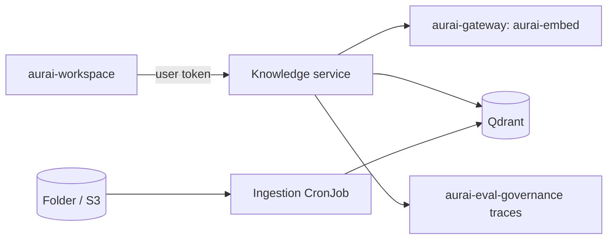

# aurai-knowledge-rag

The knowledge service of the Aurai platform: approved document collections, retrieval that respects who is asking, and a citation on every passage.

> **Synthetic project.** Aurai is a fictional enterprise AI platform for the fictional company "Amazing-Enterprise". Every document, name and number here is invented. This is a working prototype with production patterns, not a production system; the gaps are listed below.

## What it does

- **Ingests** approved collections (Markdown, text, PDF; from a folder or S3) into Qdrant. Every chunk carries `collection`, `team`, `classification`, source and freshness metadata. Content without valid metadata is not indexed.
- **Searches** with the caller's own Keycloak token. Entitlements come from the verified token's groups and are applied *inside* the vector query, so passages a caller may not read are never retrieved.
- **Cites** every passage: title, URI, collection, classification and the date the source was last confirmed.
- **Measures** itself: a golden set scores retrieval quality and fails the build if anything leaks.
- **Refreshes** on a schedule and reports collections that have gone stale.

It implements the contract in [`contracts/knowledge-service.openapi.yaml`](contracts/knowledge-service.openapi.yaml), which `aurai-workspace` calls.



## Requirements covered

From the Aurai PRD, Knowledge area:

| ID | Requirement | Where |
|---|---|---|
| KN-1 | Ingestion pipeline for approved collections | `ingest.py`, `sources.py`, `parsing.py`, `chunking.py`; [docs/ingestion-and-freshness.md](docs/ingestion-and-freshness.md) |
| KN-2 | Retrieval respects user entitlements | `entitlements.py`, `store.py`, `config/entitlements.yaml`; [docs/entitlements.md](docs/entitlements.md) |
| KN-3 | Answers carry source citations | `Source` fields on every passage in `api.py` |
| KN-4 | Freshness tracking and re-ingestion schedule | CronJob in the chart, `freshness.py` |
| KN-5 | Retrieval quality evaluation | `evaluation.py`, `eval/golden-set.yaml`; [docs/evaluation.md](docs/evaluation.md) |

## Try it without a cluster

```powershell
pip install -e ".[dev]"
pytest -q
aurai-knowledge validate-corpus --source corpus
aurai-knowledge eval
```

This runs everything in memory, with no network or keys. To deploy on the local kind cluster, see [docs/local-development.md](docs/local-development.md).

## Repository layout

| Path | Contents |
|---|---|
| `src/aurai_knowledge/` | Service (`api.py`, `service.py`, `auth.py`), entitlements, Qdrant store, ingestion, embeddings, evaluation, CLI |
| `config/entitlements.yaml` | Who may read what (reviewed like code) |
| `corpus/` | Synthetic documents: 20 files in 4 collections, with manifests |
| `eval/golden-set.yaml` | 28 evaluation cases including leak probes |
| `contracts/` | The search contract shared with the workspace |
| `charts/aurai-knowledge/` | Service Deployment, ingestion CronJob, NetworkPolicy, values for local and AWS |
| `gateway/` | Gateway team, and embedding overlays for Gemini and Ollama |
| `governance/` | Use-case registration for `aurai-eval-governance` |
| `scripts/` | Local deploy, ingest, port-forward, token helper |
| `docs/` | Architecture, entitlements, embeddings, ingestion, evaluation, local development, runbook |

## Honest status

**Verified here**
- 118 tests pass, including a persona-by-query matrix proving no caller receives a passage above their grant, and tests that fail when the filter is deliberately broken.
- The service matches the OpenAPI contract's response schema, status codes (401, 403, 422, 503) and request limits.
- Token checks: bad signature, expiry, issuer, audience, `alg: none` and an unreachable key set are all denied.
- The offline evaluation passes its thresholds with zero leaks. The use-case registration and gateway team validate with the `aurai-governance` and `aurai-teamctl` tools.

**Not verified**
- Nothing has run against a real Qdrant server, Keycloak, gateway or embedding model. Tests use `qdrant-client`'s in-memory mode (which implements filters but ignores payload indexes), locally generated signing keys, and a mocked gateway.
- The Helm chart's template syntax parses, but `helm lint`, `helm template`, kubeconform and the container build were not run here; CI runs them.
- The offline evaluation uses a word-matching embedder on 20 short documents. It proves the plumbing, not semantic quality. Online numbers depend on the embedding model you choose.
- The gateway's PII policy masks names and places in embedded text at this team's tier. The effect on retrieval quality is not measured ([docs/embeddings.md](docs/embeddings.md)).
- Whether Open WebUI passes the user's token to the workspace tool is unverified (noted in `aurai-workspace`).
- The S3 source is tested against a fake client only. PDF support covers PDFs with extractable text.

**What production would add**
- A dedicated token audience for this service, and token introspection or shorter lifetimes where immediate revocation matters.
- Qdrant authentication and network isolation, and separate collections or multitenancy for the most sensitive data, so one filter is not the only barrier.
- Hybrid (keyword plus vector) search and a reranker; a larger golden set written with collection owners; continuous evaluation against production traffic samples.
- Document-level approval workflow and lineage for the corpus, malware scanning, and OCR for scanned PDFs.
- Rate limits per caller, autoscaling, and dashboards and alerts on freshness, refusal rate and latency.
- A tested restore path for the index (it is rebuilt from the sources, which are the system of record).

## License

MIT. See [LICENSE](LICENSE).
