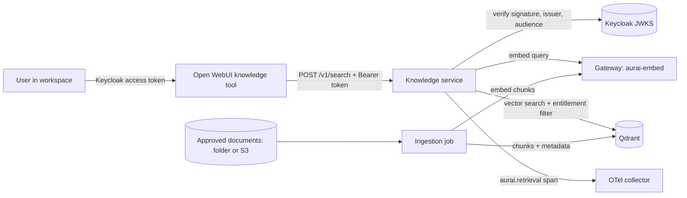

# Architecture

## Role in the platform

The knowledge service is the only component that reads document collections on behalf of users. The workspace, and later the agent runtime, call it; they never query Qdrant. This keeps entitlement checks in one place (ADR 0005 in `aurai-docs`).

## Request path

1. The workspace sends the user's own access token. The service verifies the signature against Keycloak's keys, and the issuer, audience and expiry.
2. The token's `groups` claim is resolved against `config/entitlements.yaml` into a classification ceiling per collection. Groups combine; the highest ceiling wins.
3. A `collections` list in the request can only narrow that set. If nothing is left the answer is 403, identical for a collection that does not exist and one the caller may not read.
4. The query is embedded through the gateway alias `aurai-embed`.
5. Qdrant is queried with a filter built from the entitlement: one branch per collection, each requiring `collection = c AND classification_rank <= ceiling`. The filter is part of the vector query, so unauthorized chunks are never fetched, ranked or counted.
6. Passages return with title, URI, collection, classification and the date the source was last confirmed.

## Ingestion path

1. Each collection folder (or S3 prefix) has a `collection.yaml` declaring `team`, `owner` and a default `classification`. A document may raise its classification in front matter, never lower it.
2. A document that is missing metadata, unreadable, empty, or refused by the gateway's data policy is rejected and reported. If an older copy is in the index it is removed: without valid metadata a chunk cannot be filtered, so it may not exist.
3. Valid documents are split on headings and packed into chunks of about 900 characters with a small overlap. Each chunk is embedded with its title and section heading for context.
4. Re-runs are incremental. A content-and-metadata hash skips unchanged documents (their freshness date is still refreshed), replaces changed ones, and deletes documents that disappeared from the source.

## Data model

One Qdrant collection (`aurai_knowledge`, cosine distance). Point ids are deterministic (`uuid5` of document id and chunk index), so re-ingestion overwrites rather than duplicates. Payload fields: `doc_id`, `chunk_index`, `text`, `collection`, `team`, `classification`, `classification_rank`, `title`, `uri`, `section`, `doc_hash`, `ingested_at`. Payload indexes cover `collection`, `doc_id`, `team`, `classification_rank` and `chunk_index`.

## Design decisions

| Decision | Reason | Cost |
|---|---|---|
| One Qdrant collection with payload filters | Matches ADR 0005; one index to operate and evaluate | A filter bug is a leak. Mitigated by building every filter in one function, a test matrix, and a leakage gate; production should also use separate collections or Qdrant's multitenancy features for the most sensitive data |
| Entitlements in a reviewed file, keyed by token group | Auditable in pull requests; no runtime dependency on another service | Policy changes need a deploy; group changes take effect at the next token |
| Embeddings only through the gateway alias | One place for keys, budgets, PII policy and model choice | The gateway's PII masking changes the text that is embedded (see `embeddings.md`) |
| Retrieve only, never generate | Keeps this service's risk about access and accuracy of passages; generation stays in the workspace and agents | The caller must still cite and handle empty results |
| Fail closed | Missing metadata, empty entitlement, unreachable key set, gateway refusal all mean "no access" | Some availability is traded for safety |
